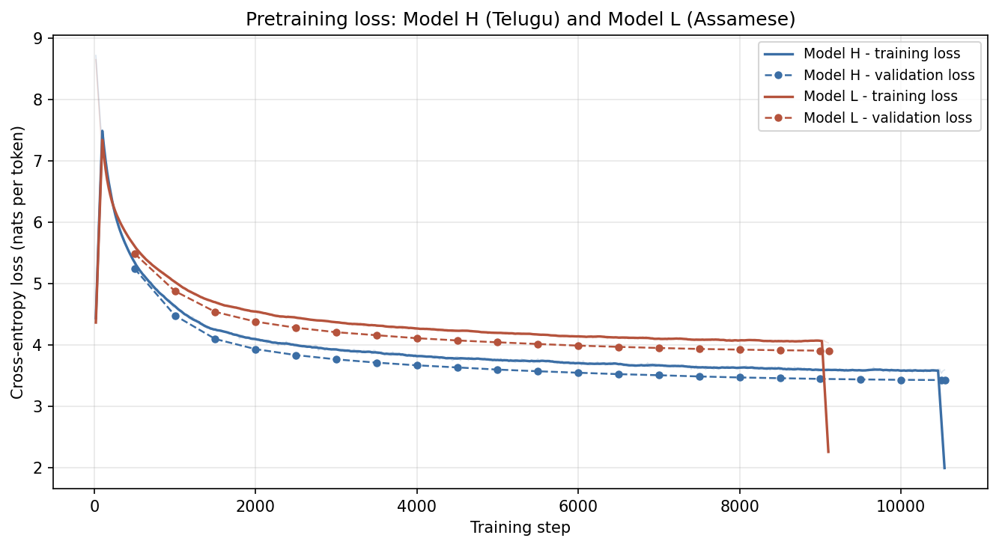
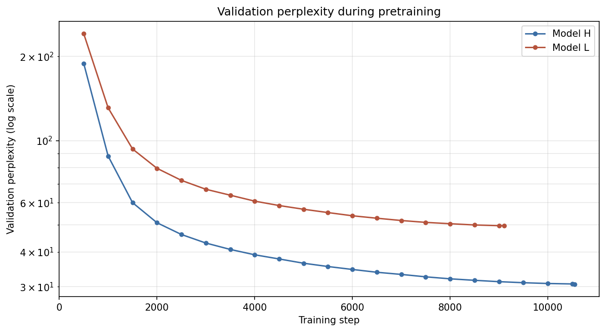

# Phase 2 — Model Implementation, Pretraining, and Evaluation

Two independent decoder-only Transformers, one per language, built from scratch
in PyTorch. Nothing is shared between them: separate corpora (Phase 1), separate
tokenizers, separate vocabularies, separate weights. They were trained as two
processes, one per GPU, not as one distributed job.

| | Model H | Model L |
|---|---|---|
| Language | Telugu (తెలుగు) | Assamese (অসমীয়া) |
| Parameters | 24,562,944 | 24,562,944 |
| Training tokens seen | 648,192,000 | 559,718,400 |
| Steps | 10,550 | 9,110 |
| Validation loss / perplexity | 3.4234 / 30.67 | 3.9043 / 49.62 |
| **Test perplexity** | **32.76** | **48.71** |
| **Test bits per byte** | **0.5369** | **0.6509** |

Every number in this report is taken from the JSON in `telugu/` and `assamese/`
alongside it, and every figure is committed in this directory. Phase 1 context is
in [Model H](../phase1/telugu/model_h_telugu.md) and
[Model L](../phase1/assamese/model_l_assamese.md); Drive links for the
checkpoints are in the [top-level README](../../README.md).

---

## 1. Architecture

Implemented in [`common/model.py`](../../common/model.py) from `nn.Linear`,
`nn.Embedding`, `nn.LayerNorm` and `nn.Dropout` only. No `nn.Transformer*`
module, no pre-built attention, no HuggingFace class. Configuration lives in
[`telugu/configs/model_h.json`](../../telugu/configs/model_h.json) and
[`assamese/configs/model_l.json`](../../assamese/configs/model_l.json), which
also carry the reasoning for each choice as `_`-prefixed documentation keys.

| | Both models |
|---|---|
| Layers | 12 |
| Heads | 6 (d_k = 64) |
| Model dimension | 384 |
| Feed-forward dimension | 1,536 (4×, GELU) |
| Context length | 512 |
| Vocabulary | 8,000 |
| Dropout | 0.1 (embedding, attention probabilities, sublayer outputs) |
| Normalization | pre-norm LayerNorm, plus a final LayerNorm |
| Weight tying | output projection tied to the token embedding |
| Positions | learned absolute, `nn.Embedding(512, 384)` |

The two are architecturally identical on purpose. They differ only in the data
they saw, so every difference in the results below is a statement about the
corpora rather than about the model.

**Parameter budget.** The embedding sits inside the ~25M target, so vocabulary,
depth and width compete for one pool:

```
token embedding     8000 × 384                    =  3,072,000
position embedding   512 × 384                    =    196,608
12 blocks          × 1,774,464                    = 21,293,568
final LayerNorm                                   =        768
lm_head            tied to the token embedding    =          0
                                                    ----------
                                                    24,562,944
```

Untied, the same model is 27,634,944 and over budget: tying is what makes twelve
layers affordable. One block costs `12 × d_model² = 1,769,472`, so every
1,769,472 parameters spent elsewhere is one layer not built — which is exactly
why Phase 1 chose an 8,000-piece vocabulary (8k affords 12 layers, 32k only 7).

**Depth over width.** 12 × 384 was preferred to a shallower, wider model of the
same size (6 × 544, say) because attention routes information one hop per layer,
and Phase 3's comparative reasoning — A > B, B > C, therefore A > C — is
multi-hop by construction. Width buys per-token capacity, which matters less at
25M than the number of routing steps available.

**Positional scheme, and what it costs.** Learned absolute embeddings, GPT-2
style, added to the token embedding before dropout. Chosen as the simplest
scheme that is clearly correct and the cleanest to ablate for the optional
bonus. It caps the context *hard* at 512: the table has 512 rows, and rows never
seen in training keep their random initialisation, so unlike sinusoidal
encodings or RoPE this model cannot extrapolate to a longer context at all.
`block_size` is a property of the trained weights, not only of the config file.

**Attention, per head.** `X` is projected to Q, K, V; each is reshaped from
`(B, T, d)` to `(B, h, T, d_k)` so the heads work in parallel subspaces; scores
are `QKᵀ/√d_k` with an additive causal mask (`0` where allowed, `-inf` above the
diagonal) applied *before* the softmax; the probabilities are dropped out and
applied to V; the heads are concatenated back to `(B, T, d)` and passed through
`W_O`. The `1/√d_k` scaling matters because the dot product of two independent
d_k-dimensional vectors has variance proportional to d_k, and without the
correction the softmax saturates as d_k grows — one key takes nearly all the
mass and the gradient through the softmax vanishes.

**Verification.** [`common/test_model.py`](../../common/test_model.py) checks
this empirically rather than by inspection: tensor shapes at every stage,
attention rows summing to 1 with zero mass above the diagonal, the causality
test that perturbs token `t+1` and asserts the logits at position `t` are
unchanged, weight tying sharing storage, the exact parameter count against the
config, single-batch overfitting to near-zero loss, greedy decoding being
deterministic while sampling is not, and `block_size` raising rather than
silently indexing out of range.

---

## 2. Pretraining

One pass over each language's training ribbon. Both models trained
simultaneously on a Kaggle T4 ×2, one model per GPU, launched by
[`common/launch_both.py`](../../common/launch_both.py); the run configs are
[`train_h.json`](../../telugu/configs/train_h.json) and
[`train_l.json`](../../assamese/configs/train_l.json).

| | Value | Why |
|---|---|---|
| Batch | 24 micro × 5 accumulation = 61,440 tokens/step | 24 is what 16 GB holds at T=512; accumulation sets the real batch |
| Optimizer | AdamW, β 0.9 / 0.95, weight decay 0.1, clip 1.0 | β₂ 0.999 would average the second moment over ~1,000 steps, a tenth of the run |
| Learning rate | 6e-4, 400 warmup steps, cosine to 6e-5 | Adam's first few hundred updates are oversized and land on random weights |
| Precision | fp16 + GradScaler | see below |
| Seed | 42 | |

**fp16 rather than bf16, on a card that claims to support both.**
`torch.cuda.is_bf16_supported()` returns `True` on a T4, which is misleading: a
T4 is Turing and has no bf16 hardware, so what is being reported is emulation —
slower than fp16, not faster.

| | Model H | Model L |
|---|---|---|
| Steps | 10,550 | 9,110 |
| Tokens seen | 648,192,000 | 559,718,400 |
| Tokens per parameter | 26 | 23 |
| Wall clock | 5:17:58 | 4:34:10 |
| Mean throughput | 34,030 tok/s | 34,079 tok/s |
| Final validation loss | 3.4234 | 3.9043 |
| Final validation perplexity | 30.67 | 49.62 |

Both runs are a single epoch. At 24.6M parameters, 26 tokens per parameter is
near the compute-optimal ratio for a model this size, so one pass is a principled
budget rather than an arbitrary stopping point. The near-identical throughput
across two different corpora is expected — the models are the same shape, and
the data is pre-tokenized into fixed 512-token windows.

**Logs and curves.** `telugu/train_log.jsonl` and `assamese/train_log.jsonl` are
one JSON object per record (`train` lines with step, loss, perplexity, learning
rate, tokens, throughput and elapsed time; `eval` lines with the validation loss
and whether it was a new best; a final `done` line with the totals).
`console.log` beside each is the run's stdout, including the resolved
configuration, the parameter count and every checkpoint write.
[`common/plots.py`](../../common/plots.py) draws the curves from the JSONL:





Also in `figures/`: `pretrain_learning_rate.png` (warmup and cosine decay),
`pretrain_throughput.png`, and `pretrain_loss_vs_tokens.png`, which puts both
models on a common x-axis of tokens seen and is the fair way to compare them —
Model L's curve sits above Model H's for the whole run, not only at the end.

**Checkpointing and resume.** Every checkpoint carries model weights, optimizer
state, scheduler state, training step, sampler position, RNG state and the
config. [`common/test_train_resume.py`](../../common/test_train_resume.py)
proves bit-for-bit that a resumed run continues the run it interrupted: step
4,001 after a resume is the step 4,001 the uninterrupted run would have
produced. This was not academic — an interactive Kaggle session ended and took
`/kaggle/working` with it, which is why the final runs were launched with **Save
& Run All**.

---

## 3. Language-modelling evaluation

[`common/evaluate.py`](../../common/evaluate.py) on each model's own test split.
Neither model has seen it, and neither tokenizer was trained on it.

| | Model H (Telugu) | Model L (Assamese) |
|---|---|---|
| Cross-entropy | 3.4891 nats/token | 3.8859 nats/token |
| Perplexity | 32.76 | 48.71 |
| Bits per token | 5.0337 | 5.6062 |
| **Bits per byte** | **0.5369** | **0.6509** |
| Test tokens | 3,197,440 | 2,881,024 |
| Test bytes | 29,977,573 | 24,813,495 |

**Bits per byte is the only figure here that compares the two models.**
Perplexity is per *token*, and a token means something different in each model:
the tokenizers were trained on different corpora and segment at different rates
(3.54 vs 3.16 characters per token). A model with a coarser tokenizer is asked
fewer, harder questions, so its perplexity is inflated for a reason that has
nothing to do with how well it models the language. Normalising to bytes removes
that, and on bytes Model H leads by 0.114 bits — smaller than the perplexity gap
of 16 points suggests, and the honest size of the difference.

Per source, on the first 2,000 test documents:

| Model H (Telugu) | docs | tokens | ppl | bits/byte |
|---|---:|---:|---:|---:|
| wikipedia | 395 | 157,439 | 10.88 | 0.3561 |
| sangraha | 400 | 139,568 | 28.27 | 0.4767 |
| textbook | 74 | 33,399 | 36.37 | 0.6521 |
| wikisource | 39 | 18,110 | 34.01 | 0.9219 |
| archive | 7 | 3,584 | 34.58 | 1.0084 |

| Model L (Assamese) | docs | tokens | ppl | bits/byte |
|---|---:|---:|---:|---:|
| wikipedia | 101 | 38,992 | 35.09 | 0.5405 |
| sangraha | 500 | 168,959 | 36.54 | 0.5463 |
| wikisource | 286 | 95,366 | 73.52 | 0.7722 |
| archive | 8 | 4,096 | 45.14 | 1.0914 |

Both models rank their sources the same way, and **the spread within a language
is wider than the gap between the languages**: Telugu Wikipedia costs 0.356
bits/byte while Telugu Archive costs 1.008, nearly three times as much. That is
a statement about scan quality, not about either language — the Archive rows are
OCR output and the model is paying for the errors.

Note that the two columns disagree about which source is hardest. Telugu
`textbook` has the worst perplexity (36.37) but `archive` the worst bits/byte
(1.0084), because OCR noise fragments into many short tokens: each individual
token is easier to predict, and there are far more of them per byte of text.
The same normalisation argument that applies between the models applies here.

---

## 4. Generation

[`common/generate.py`](../../common/generate.py): 200 held-out documents, a
64-token prefix continued for 64 tokens, against the document's true
continuation, under four decoding settings.

| Model H (Telugu) | BLEU-4 | chrF2 | ROUGE-L | dist-1 | dist-2 | rep-4 |
|---|---:|---:|---:|---:|---:|---:|
| greedy | 5.351 | 15.675 | 0.0751 | 0.2185 | 0.2982 | 0.539 |
| t = 0.5 | **5.823** | 18.092 | 0.0826 | 0.3956 | 0.5922 | 0.234 |
| t = 1.0 | 4.114 | **22.726** | 0.0671 | 0.7277 | 0.9585 | 0.004 |
| t = 1.5 | 0.928 | 20.204 | 0.0225 | 0.7980 | 0.9974 | 0.000 |

| Model L (Assamese) | BLEU-4 | chrF2 | ROUGE-L | dist-1 | dist-2 | rep-4 |
|---|---:|---:|---:|---:|---:|---:|
| greedy | 1.420 | 13.765 | 0.0487 | 0.1732 | 0.2848 | 0.574 |
| t = 0.5 | **1.791** | 17.256 | 0.0612 | 0.3413 | 0.6418 | 0.173 |
| t = 1.0 | 0.606 | **19.022** | 0.0447 | 0.6358 | 0.9738 | 0.000 |
| t = 1.5 | 0.102 | 18.068 | 0.0204 | 0.6992 | 0.9976 | 0.000 |

**Greedy decoding degenerates.** A 4-gram repetition rate of 0.539 means over
half the output n-grams are repeats, with distinct-1 at 0.22 — and
`<lang>/generation_samples_test.md` shows it directly, as a single token repeated
to the length limit. This is the expected failure mode at 24.6M parameters, not a
decoder bug: the argmax path has no mechanism to leave a loop once it enters one.

**The metrics disagree, and chrF is the one to believe here.** BLEU-4 peaks at
t=0.5 while chrF2 peaks at t=1.0. chrF is character-based, so it does not depend
on how these scripts are split into words; BLEU's `intl` tokenizer splits on
Unicode punctuation and leaves Indic runs intact, which is the best option
available but still a word-level assumption imported from English. BLEU-4 is
also near its own noise floor at these values — Model L's 1.79 rests on a 4-gram
precision of 0.38%, where a handful of coincidental matches moves the score.
Read by chrF, t=1.0 is the best decoding for both models and greedy is the
*worst*, despite greedy ranking second on BLEU.

**Why these metrics are weak evidence for open-ended LM generation at all.** All
three score a sample against *one* reference continuation, but a continuation
can be fluent, on-topic and entirely correct while sharing almost no n-grams
with what the document actually went on to say. That is why the diversity
diagnostics carry as much weight here: rep-4 and distinct-1/2 measure a real
failure (degeneracy) without assuming there is only one right answer. Read
together they say the same thing — as temperature rises, repetition collapses
from 0.54 to 0.00 and distinct-2 climbs to ~0.99, and somewhere around t=1.0 the
output stops repeating itself without yet becoming noise. At t=1.5 the diversity
numbers look excellent precisely *because* the text has stopped being Telugu or
Assamese in any useful sense; diversity metrics have no upper bound of good
taste, which is why they are reported next to chrF rather than instead of it.

Qualitatively, the samples in `telugu/generation_samples_test.md` and
`assamese/generation_samples_test.md` are locally plausible — correct script,
plausible morphology, well-formed short phrases — and globally incoherent, drifting
off the prefix's topic within a clause or two. The weakest samples are
continuations of OCR-heavy Archive prefixes, where the prefix itself is partly
garbage and the model faithfully continues the garbage. Every score carries its
sacrebleu signature in `<lang>/generation_test.json`, so the numbers can be
reproduced rather than merely quoted.

---

## 5. Attention analysis

[`common/attention.py`](../../common/attention.py): 8 test sequences of 128
tokens, all 12 layers and all 6 heads. Entropy is normalised against a uniform
distribution over the positions each query is *allowed* to see, so early
positions with few keys are not counted as artificially sharp; distance is
measured over the second half of the sequence for the same reason.

Layer means (each the mean over that layer's 6 heads):

| layer | H entropy | H distance | L entropy | L distance |
|---:|---:|---:|---:|---:|
| 0 | 0.908 | 41.02 | 0.907 | 41.31 |
| 1 | 0.876 | 47.99 | 0.884 | 48.89 |
| 2 | 0.720 | 38.69 | 0.698 | 31.47 |
| 3 | 0.574 | 9.56 | 0.635 | 24.10 |
| 4 | 0.536 | 8.24 | 0.644 | 15.86 |
| 5 | **0.399** | 12.50 | 0.458 | 8.72 |
| 6 | 0.417 | 34.45 | 0.565 | 19.44 |
| 7 | 0.597 | 38.92 | 0.550 | 19.34 |
| 8 | 0.486 | 41.62 | **0.354** | **55.37** |
| 9 | 0.597 | 47.49 | 0.613 | 45.03 |
| 10 | 0.662 | 46.16 | 0.700 | 43.30 |
| 11 | 0.758 | 45.82 | 0.738 | 47.12 |

Both models learned the same three-part structure, without being told to:

1. **Layers 0–1 attend broadly and at long range** (normalised entropy ≈ 0.9).
   Nothing has been resolved yet, so the cheapest useful thing a head can do is
   average widely.
2. **The middle collapses to sharp local attention.** Telugu layers 3–5 look 8–12
   positions back with entropy bottoming at 0.399; the sharpest single heads are
   nearly one-hot — H's L5H5 at entropy 0.015 and distance 1.10 is a
   previous-token head, and L's L6H3 (0.019, 1.14) is the same head in the other
   model. This is where local morphology and syntax get assembled.
3. **The last four layers re-broaden** (entropy back to ~0.75, distance ~46).
   Local structure is finished, and the top of the stack is doing discourse.

Head-type census, labelled against each model's own medians:

| | long-range diffuse | local focused | local diffuse | long-range focused |
|---|---:|---:|---:|---:|
| Model H | 22 | 22 | 14 | 14 |
| Model L | 26 | 26 | 10 | 10 |

**Model L layer 8 is the one departure from the shared pattern**, and the most
interesting thing in either model: the sharpest attention anywhere (mean entropy
0.354, with L8H0 at 0.134) combined with the longest mean distance (55.37, with
L8H0 reaching back 84.58 positions on average within a 128-token window). Sharp *and* long-range is the signature of a
retrieval head — one that goes back to a specific earlier position rather than
smoothing over a neighbourhood. Model H has heads of this type too (L8H5 at
0.236 / 76.86, L6H2 at 0.197 / 74.98) but they are scattered across layers 6–8
rather than concentrated into one; Model L's are pooled in a single layer.

Heatmaps for an early and a late layer are in `<lang>/figures/`
(`attention_heatmap_layer0.png`, `attention_heatmap_layer11.png`), with entropy
and distance by layer in `attention_by_layer.png`, `attention_entropy.png` and
`attention_distance.png`. Per-head tables, the example sentences in each
language and their position-by-position tokenizations are in
[`telugu/attention_notes.md`](telugu/attention_notes.md) and
[`assamese/attention_notes.md`](assamese/attention_notes.md). Heatmap axes are
labelled by position rather than by token because matplotlib renders missing
Indic glyphs as empty boxes; the notes let any position be looked up.

Phase 3 re-runs this same toolkit on the finetuned checkpoints, and layer 8 of
Model L is the obvious thing to watch: if comparative reasoning needs to carry a
fact from one clause to a later one, a retrieval head is the mechanism that
would have to do it.

---

## 6. Resource-level comparison

The two models are the same architecture, the same size, the same
hyperparameters, the same seed, trained for the same number of epochs on the
same hardware. Every difference below is therefore attributable to the data.

| | Model H (Telugu) | Model L (Assamese) |
|---|---|---|
| Training tokens | 647,207,005 | 559,359,252 (86% of H) |
| Manual share | 22.02% | **55.80%** |
| Largest source | Sangraha, 78.0% | Internet Archive, 48.9% |
| Characters per token | 3.54 | 3.16 |
| Test bits per byte | 0.5369 | 0.6509 |
| Best chrF2 | 22.73 | 19.02 |

**The resource tiers inverted on manual collection.** Model L carries 55.80%
manually collected tokens against Model H's 22.02%, not because more effort went
into Assamese but because there was nothing else to use: Telugu could lean on
Sangraha for 78% of its tokens, while Assamese had to be built from historical
book scans. The Phase 1 availability gap was 259× on Internet Archive items and
~15× on Sangraha shards.

That inversion is what the Phase 2 numbers are measuring. Three effects
compound:

1. **Less data.** 559M tokens against 647M — a 14% shortfall, and the smaller of
   the two corpora is also the one that needed the harder sourcing.
2. **Noisier data.** Nearly half of Model L's tokens are OCR of old scans. The
   per-source table prices this directly: Archive text costs 1.09 bits/byte
   against Wikipedia's 0.54, so half of Model L's training distribution is drawn
   from the expensive end of its own quality range.
3. **A tokenizer fitted to that noise.** Assamese segments at 3.16 characters per
   token against Telugu's 3.54, so Model L sees ~11% less text in the same 512
   positions — its effective context is shorter in characters, and each 512-token
   window covers less of a document. OCR fragmentation is the cause: broken words
   fall back to short pieces, which is also why the tokenizer's own held-out
   fertility was worse.

The gap they produce is 0.114 bits/byte and ~3.7 chrF2. Two things are worth
saying about its size. It is **real and consistent** — it is not something that
opened up at the end of training. Compared at *matched token counts*, which is
the only fair way to read two runs of different lengths, Model L's training loss
is above Model H's throughout:

| tokens seen | 30.7M (first eval) | 100M | 200M | 400M | 559M |
|---|---:|---:|---:|---:|---:|
| Model H | 5.242 val | 4.214 | 3.855 | 3.705 | 3.587 |
| Model L | 5.487 val | 4.646 | 4.357 | 4.130 | 4.032 |

The gap is 0.245 nats at the first validation and 0.445 at 559M tokens — present
from the start, widening slowly rather than converging, and it shows up again in
the test set and in generation quality at every temperature.

But the gap is also **smaller than the perplexity headline suggests**: 32.76
against 48.71 looks like a chasm, and on bytes it is 21%. It is smaller, too,
than the within-language spread across sources — Telugu's own worst source costs
0.65 bits/byte more than its best. The lower-resource model is not failing — it is paying
a measurable, well-understood premium for a corpus it had to scrape together.

Phase 3 tests whether that premium is bigger or smaller on reasoning than it is
on language modelling, on synthetic data where both models get *identical*
supervision by construction — which removes data quantity and quality from the
comparison and leaves only what pretraining built.

---

## 7. Deliverables

| # | Deliverable | Where |
|---|---|---|
| 1 | Transformer implementation (MHA, positions, causal mask) | [`common/model.py`](../../common/model.py), tests in [`common/test_model.py`](../../common/test_model.py) |
| 2 | Model configuration files | [`telugu/configs/model_h.json`](../../telugu/configs/model_h.json), [`assamese/configs/model_l.json`](../../assamese/configs/model_l.json) |
| 3 | Parameter counts, training scripts, checkpoints | 24,562,944 each; [`common/train.py`](../../common/train.py), [`common/launch_both.py`](../../common/launch_both.py); Drive links in the [README](../../README.md) |
| 4 | Training logs and loss curves | `<lang>/train_log.jsonl`, `<lang>/console.log`, `figures/` |
| 5 | PPL / BPB tables; BLEU, chrF, ROUGE-L | §3, §4; `<lang>/eval_test.json`, `<lang>/generation_test.json` |
| 6 | Generated samples, diversity and repetition | `<lang>/generation_samples_test.md`, `<lang>/generation_samples_test.json` |
| 7 | Attention heatmaps, entropy and distance | §5; `<lang>/attention.json`, `<lang>/attention_notes.md`, `<lang>/figures/` |
| 8 | Resource-level comparison | §6 |

### Reproducing

Training runs on Kaggle;
[`notebooks/phase2_kaggle_pretrain.py`](../../notebooks/phase2_kaggle_pretrain.py)
is the source of the notebook, so the run is reproducible from this branch
rather than only from a Kaggle account. Accelerator **GPU T4 ×2**, Internet
**On**, *Add Data* for `lma-code` and both `lma-<language>-tokens` datasets, and
launch with **Save & Run All** — an interactive session that ends takes
`/kaggle/working` with it, checkpoints included.

Evaluation, against a downloaded checkpoint:

```bash
python common/evaluate.py  --checkpoint <best.pt> --split test --out report/phase2/<lang>
python common/generate.py  --checkpoint <best.pt> --split test --out report/phase2/<lang> --n-samples 200
python common/attention.py --checkpoint <best.pt> --split test --out report/phase2/<lang> --n-sequences 8
python common/plots.py --runs <runs directory> --out report/phase2
```
